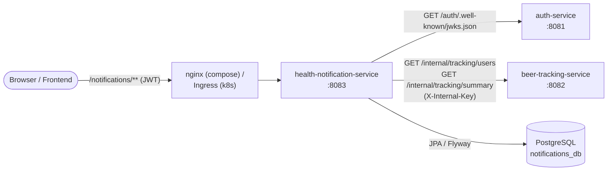
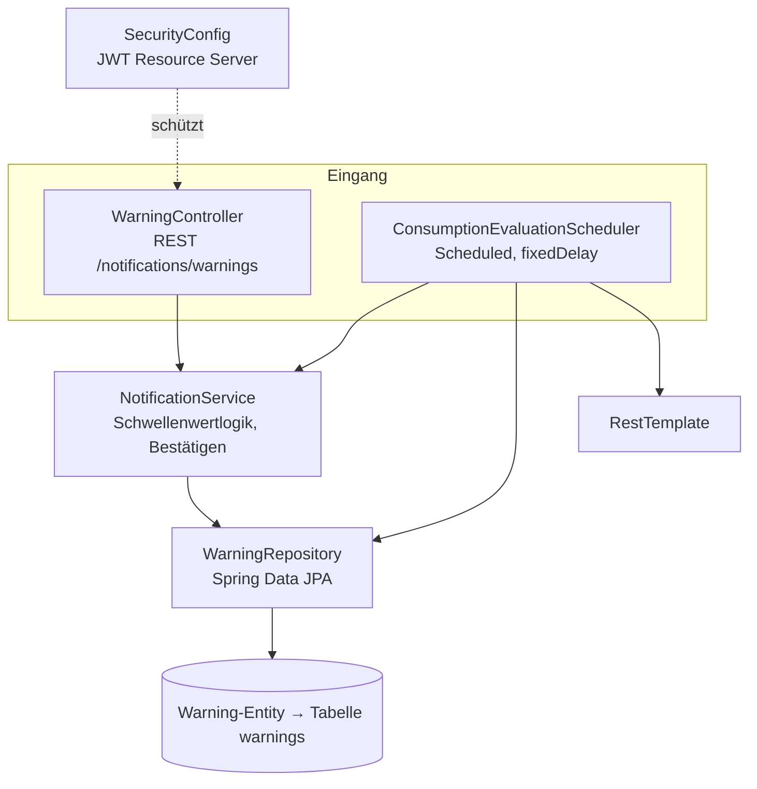
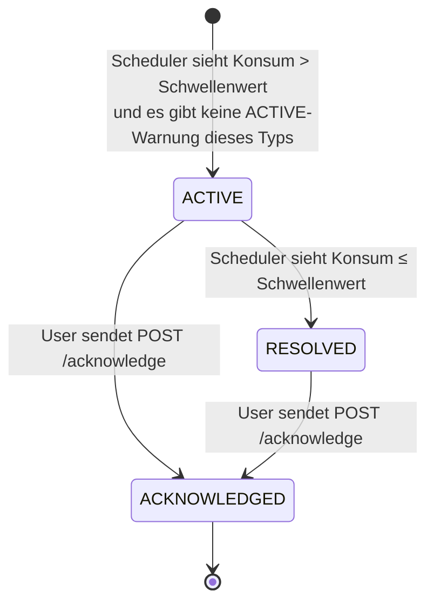
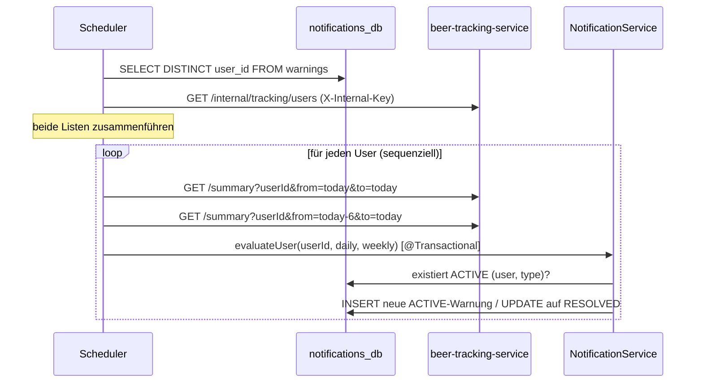

# Health Notification Service – Architekturübersicht

## 1. Zweck

Der `health-notification-service` überwacht den Bierkonsum jedes Users und erzeugt eine **Warnung**, wenn ein konfiguriertes Limit überschritten wird. Den Konsum erfasst er nicht selbst. Er fragt den `beer-tracking-service` in festen Abständen ab, vergleicht die Summen mit den Schwellenwerten und speichert Warnungen in seiner eigenen Datenbank. User können ihre Warnungen über eine kleine REST-API abrufen und bestätigen.

| Aspekt | Wert |
|---|---|
| Quellcode | [services/health-notification-service](../../services/health-notification-service) |
| Helm-Chart | [charts/health-notification-service](../../charts/health-notification-service) |
| Spezifikation | [openspec/specs/health-notifications/spec.md](../../openspec/specs/health-notifications/spec.md) |
| Stack | Java 21, Spring Boot 3.3.4 (Web, Data JPA, Security / OAuth2 Resource Server, Actuator), Flyway, PostgreSQL |
| Port | `8083` |
| Datenbank | `notifications_db` (eigene Datenbank auf der gemeinsamen PostgreSQL-Instanz) |
| Umfang | ca. 940 Codezeilen (9 Hauptklassen, 1 Unit-Test-Klasse) |

## 2. Einbettung ins Gesamtsystem

| Abhängigkeit | Richtung | Zweck | Auswirkung bei Ausfall |
|---|---|---|---|
| `auth-service` | ausgehend | Liefert das JWKS, mit dem die JWTs der User geprüft werden (RS256) | User-API antwortet mit 401; der Scheduler läuft weiter |
| `beer-tracking-service` | ausgehend | Quelle der User-Liste und der Konsumsummen | Die Auswertung läuft weiter, der Konsum wird dabei als 0 gewertet (siehe §7) |
| PostgreSQL `notifications_db` | ausgehend | Speichert die Warnungen; Flyway-Migrationen laufen beim Start | Service startet nicht oder meldet sich nicht ready; API antwortet mit 5xx |
| nginx / Ingress | eingehend | Leitet `/notifications` auf Port 8083 weiter | – |

Kein anderer Service ruft diesen Service auf. Er ist ein Blatt im Abhängigkeitsgraphen und liest nur von anderen.

## 3. Interne Struktur

Der Service folgt dem üblichen Spring-Schichtenaufbau (`com.beertracker.notification`):

| Komponente | Datei | Aufgabe |
|---|---|---|
| `HealthNotificationApplication` | [HealthNotificationApplication.java](../../services/health-notification-service/src/main/java/com/beertracker/notification/HealthNotificationApplication.java) | Einstiegspunkt der Boot-Anwendung; aktiviert das Scheduling (`@EnableScheduling`) |
| `SecurityConfig` | [SecurityConfig.java](../../services/health-notification-service/src/main/java/com/beertracker/notification/config/SecurityConfig.java) | Zustandsloser JWT Resource Server ohne CSRF; lässt `/actuator/health/**` und `/actuator/info` offen; stellt das `RestTemplate`-Bean bereit |
| `WarningController` | [WarningController.java](../../services/health-notification-service/src/main/java/com/beertracker/notification/controller/WarningController.java) | REST-API für die User; liest die User-ID aus dem `sub`-Claim des JWT |
| `ConsumptionEvaluationScheduler` | [ConsumptionEvaluationScheduler.java](../../services/health-notification-service/src/main/java/com/beertracker/notification/scheduler/ConsumptionEvaluationScheduler.java) | Periodischer Job: sammelt User-IDs, holt Tages- und Wochensummen und übergibt sie an den Service |
| `NotificationService` | [NotificationService.java](../../services/health-notification-service/src/main/java/com/beertracker/notification/service/NotificationService.java) | Geschäftslogik: Warnungen anlegen, auflösen und bestätigen; paginierte Abfrage |
| `WarningRepository` | [WarningRepository.java](../../services/health-notification-service/src/main/java/com/beertracker/notification/repository/WarningRepository.java) | Datenzugriff, inklusive `findDistinctUserIds()` |
| `Warning` | [Warning.java](../../services/health-notification-service/src/main/java/com/beertracker/notification/entity/Warning.java) | JPA-Entity mit den Enums `WarningType` und `WarningStatus` |
| `WarningResponse`, `PagedResponse` | [dto/](../../services/health-notification-service/src/main/java/com/beertracker/notification/dto) | Records für die API-Antworten |

## 4. Datenmodell

Es gibt eine einzige Tabelle. Sie wird von der Flyway-Migration [V1__create_warnings_table.sql](../../services/health-notification-service/src/main/resources/db/migration/V1__create_warnings_table.sql) angelegt. Hibernate läuft mit `ddl-auto: validate`, das Schema gehört also ausschließlich Flyway.

| Spalte | Typ | Hinweis |
|---|---|---|
| `id` | UUID PK | `gen_random_uuid()` |
| `user_id` | UUID | Indiziert |
| `type` | VARCHAR(50) | `DAILY_EXCEEDED` \| `WEEKLY_EXCEEDED` |
| `status` | VARCHAR(50) | `ACTIVE` \| `RESOLVED` \| `ACKNOWLEDGED` |
| `triggered_at`, `resolved_at`, `acknowledged_at` | TIMESTAMPTZ | Zeitstempel des Lebenszyklus |
| `threshold` | DECIMAL(5,2) | Schwellenwert, der beim Auslösen der Warnung galt |

Indizes: `(user_id)` und `(user_id, type, status)`. Es gibt **keinen** Unique-Constraint, der zwei `ACTIVE`-Warnungen desselben Typs für einen User verhindert.

### Lebenszyklus einer Warnung

## 5. Laufzeitabläufe

### 5.1 Geplante Auswertung (Kernschleife)

Der Job wird über `@Scheduled(fixedDelay = SCHEDULER_EVALUATION_DELAY_MS)` ausgelöst. Der Default ist 300 000 ms (5 min); docker-compose setzt 5 000 ms.

- **Täglich** bedeutet der aktuelle Kalendertag in UTC. **Wöchentlich** bedeutet ein gleitendes 7-Tage-Fenster, das heute (UTC) endet, keine Kalenderwoche.
- Eine Warnung wird ausgelöst, wenn `aktuell > Schwellenwert` gilt (echt größer). Die Defaults sind 2 pro Tag und 14 pro Woche, angelehnt an die WHO-Empfehlungen für risikoarmen Konsum.
- Jeder Durchlauf macht bei N Usern 1 + 2·N HTTP-Aufrufe. Alle laufen nacheinander auf dem einzigen Scheduler-Thread.
- Eine Exception bei einem User wird auf WARN-Level geloggt, danach macht die Schleife mit dem nächsten User weiter.

### 5.2 User-API

Alle Endpunkte verlangen ein gültiges Bearer-JWT. Der User wird über `UUID.fromString(jwt.sub)` bestimmt.

| Methode & Pfad | Verhalten |
|---|---|
| `GET /notifications/warnings?status=&page=0&size=20` | Paginierte Warnungen des aufrufenden Users, neueste zuerst (`triggeredAt DESC`), optional nach Status gefiltert |
| `POST /notifications/warnings/{id}/acknowledge` | Setzt die Warnung auf `ACKNOWLEDGED`. Antwortet mit 404, wenn die Warnung nicht existiert, und mit 403, wenn sie einem anderen User gehört. Ein erneuter Aufruf ändert nichts |

### 5.3 Sicherheitsmodell

- **User → Service:** OAuth2 Resource Server. Das JWT wird gegen das JWKS des auth-service geprüft (`JWKS_URI`). Es gibt keine Sessions.
- **Service → beer-tracking-service:** gemeinsames Secret im Header `X-Internal-Key` (`INTERNAL_API_KEY`). Ist der Key leer, wird der Header weggelassen, und der Tracking-Service lehnt den Aufruf mit 401 ab.
- **Endpunkte ohne Authentifizierung:** `/actuator/health/**` und `/actuator/info`. Alle anderen Pfade, auch `/actuator/prometheus`, verlangen ein JWT.

## 6. Deployment & Betrieb

### Build

Es gibt zwei Build-Wege:

- Ein Multi-Stage-[Dockerfile](../../services/health-notification-service/Dockerfile): Maven-Build, danach ein Runtime-Image auf Basis von `eclipse-temurin:21-jre-alpine`. Die Tests werden in diesem Build übersprungen.
- Das Jib-Plugin in der `pom.xml`, das ein Image auf derselben Basis erzeugt.

### Umgebungen

| | docker-compose | Kubernetes (Helm) |
|---|---|---|
| Routing | nginx `location /notifications` → `health-notification-service:8083` | Ingress-Pfad `/notifications` → Service `beer-tracker-health-notification-service:8083` (ClusterIP) |
| Konfiguration | Inline-`environment:` in [docker-compose.yml](../../docker-compose.yml) | ConfigMap (`SPRING_PROFILES_ACTIVE=kubernetes`, Schwellenwerte), Umgebungsvariablen aus `values-minikube.yaml` / `values-azure.yaml`, Secret `beer-tracker-secrets` (DB-Passwort, `INTERNAL_API_KEY`) |
| Scheduler-Intervall | 5 s | 5 min (Default) |
| Replicas | 1 | `replicaCount: 1`; ein HPA ist im Chart vorhanden, aber deaktiviert (1–5 Replicas, 60 % CPU) |
| Ressourcen | – | Requests 250m / 512Mi, Limits 1 CPU / 1Gi |
| Startreihenfolge | `depends_on`: postgres (healthy), auth, tracking | Nur über Probes |

### Konfigurationsreferenz

| Variable | Default | Zweck |
|---|---|---|
| `DB_URL` / `SPRING_DATASOURCE_URL` | `jdbc:postgresql://localhost:5432/beertracker` | Datenbankverbindung. Die Deployments setzen die `SPRING_DATASOURCE_*`-Variablen, die Vorrang haben |
| `DB_USERNAME`, `DB_PASSWORD` (oder `SPRING_DATASOURCE_*`) | `beertracker` | Zugangsdaten der Datenbank |
| `JWKS_URI` | – (Pflicht) | JWKS-Endpunkt des auth-service |
| `BEER_TRACKING_INTERNAL_URL` | `http://beer-tracking-service:8082` | Basis-URL des Tracking-Service |
| `INTERNAL_API_KEY` | leer | Gemeinsames Secret für die interne API |
| `THRESHOLD_DAILY_DRINKS` / `THRESHOLD_WEEKLY_DRINKS` | `2` / `14` | Schwellenwerte für Warnungen |
| `SCHEDULER_EVALUATION_DELAY_MS` | `300000` | Pause zwischen dem Ende eines Durchlaufs und dem Start des nächsten |

### Observability

- **Health-Probes:** Die Actuator-Gruppen für Liveness und Readiness sind aktiviert. Kubernetes nutzt eine `startupProbe` (bis zu 300 s, weil mit Dynatrace-Injection ein Start von rund 80 s beobachtet wurde) sowie Liveness- und Readiness-Probes, alle auf `/actuator/health/{liveness,readiness}`. `show-details: always` ist gesetzt.
- **Logging:** JSON über `LogstashEncoder` (Feld `service=health-notification-service`, inklusive MDC) in allen Profilen außer `local` und `test`, die Klartext loggen. Jeder Scheduler-Durchlauf schreibt auf INFO-Level eine Zeile „started“ und eine Zeile „completed for N users“. Anlegen und Auflösen von Warnungen werden ebenfalls auf INFO geloggt.
- **Metriken:** `prometheus` steht in der Actuator-Exposure-Liste, aber die Dependency `micrometer-registry-prometheus` **fehlt**, deshalb existiert der Endpunkt nicht. Eigene Metriken (Dauer des Scheduler-Laufs, angelegte Warnungen, fehlgeschlagene Tracking-Aufrufe) sind nicht definiert.
- **Tracing:** In der Anwendung selbst gibt es keines. Nur die im Chart erwähnte Dynatrace-OneAgent-Injection liefert Tracing.

## 7. Architekturbeobachtungen & Risiken (SRE-Sicht)

| # | Beobachtung | Folge | Mögliche Abhilfe |
|---|---|---|---|
| 1 | **Kein verteilter Lock für den Scheduler.** Migration `V2` sagt, dass Advisory Locks (`pg_try_advisory_lock`) verwendet werden, aber kein Code holt einen. | Bei mehr als einer Replica (oder mit aktiviertem HPA) führt jeder Pod den Job aus. Beide können die Prüfung `exists ACTIVE` bestehen und doppelte `ACTIVE`-Warnungen anlegen; kein Unique-Constraint verhindert das. | Den Durchlauf mit `pg_try_advisory_lock` absichern oder ShedLock verwenden. Einen partiellen Unique-Index auf `(user_id, type) WHERE status='ACTIVE'` anlegen. |
| 2 | **Ein Ausfall des Tracking-Service wird als Konsum 0 gewertet.** Wirft der Summary-Aufruf eine Exception, bleiben `daily` und `weekly` bei `0.0`, und `evaluateUser` wird trotzdem aufgerufen. | Ein Ausfall des `beer-tracking-service` **löst stillschweigend alle ACTIVE-Warnungen auf**. Sobald der Service wieder läuft, werden die Warnungen neu ausgelöst. Das ist ein Datenqualitätsproblem und erzeugt zusätzlich Alarm-Rauschen. | Die Auswertung für diesen User überspringen, wenn der Abruf fehlschlägt, und den Fehler in einer Metrik zählen. |
| 3 | **`RestTemplate` hat keine Timeouts.** Es wird mit `new RestTemplate()` erzeugt. | Hängt der Tracking-Service, blockiert er den einzigen Scheduler-Thread auf unbestimmte Zeit. Die Auswertung bleibt stehen, ohne dass ein Fehler geloggt wird. | Connect- und Read-Timeouts setzen; Retry oder Circuit Breaker (Resilience4j) in Betracht ziehen. |
| 4 | **Der Scheduler macht sequenziell N+1 HTTP-Aufrufe.** | Die Laufzeit wächst linear mit der Anzahl der User (2 Aufrufe pro User). Es gibt weder Batching noch Parallelität. | Einen Batch-Summary-Endpunkt im Tracking-Service ergänzen oder die User parallel mit begrenzter Nebenläufigkeit auswerten. |
| 5 | **Das Verhalten beim Bestätigen kann User überraschen.** Der Scheduler prüft nur auf `ACTIVE`-Warnungen. | Bestätigt ein User eine Warnung, während er noch über dem Limit liegt, löst der nächste Durchlauf (unter compose 5 s später) eine neue `ACTIVE`-Warnung aus. | Festlegen, ob „bestätigt“ neue Warnungen für den laufenden Tag bzw. die laufende Woche unterdrücken soll, und den Code an die Spezifikation anpassen. |
| 6 | **Das Wochenfenster ist gleitend, die Spezifikation sagt aber „this week“.** | Die Wochenwarnung kann an jedem beliebigen Tag aufgelöst oder neu ausgelöst werden, nicht nur an einer Wochengrenze. | Klären, welche Semantik gewollt ist, und entweder die Spezifikation oder den Code anpassen. |
| 7 | **Der Prometheus-Endpunkt ist freigegeben, funktioniert aber nicht**, und es gibt keine Service-Metriken. | SLOs für den Scheduler (Aktualität, Erfolgsquote) lassen sich aus dem Service heraus nicht messen. | `micrometer-registry-prometheus` ergänzen, eigene Timer und Counter einführen, eventuell ein Gauge `last_successful_run`. |
| 8 | **Readiness spiegelt nicht den Zustand des Schedulers oder seiner Abhängigkeiten wider.** | Ein Pod kann sich ready melden, während seine Auswertungsschleife hängt (siehe #3). | Einen eigenen Health-Indicator ergänzen, der auf dem Zeitpunkt des letzten erfolgreichen Durchlaufs basiert. |
| 9 | **Ein `sub`-Claim, der keine UUID ist, führt zu einer unbehandelten `IllegalArgumentException`.** | Die API antwortet mit 500 statt mit 401 oder 400. | Den Claim validieren und den Fehler auf eine 4xx-Antwort abbilden. |
| 10 | **Tests decken nur `NotificationService` ab** (7 Mockito-Unit-Tests). | Fehlerbehandlung des Schedulers, Security-Konfiguration, Controller und Repository-Abfragen sind ungetestet. | Einen `@WebMvcTest` für Controller und Security ergänzen, einen Integrationstest mit Testcontainers sowie Scheduler-Tests mit gemocktem `RestTemplate`. |
